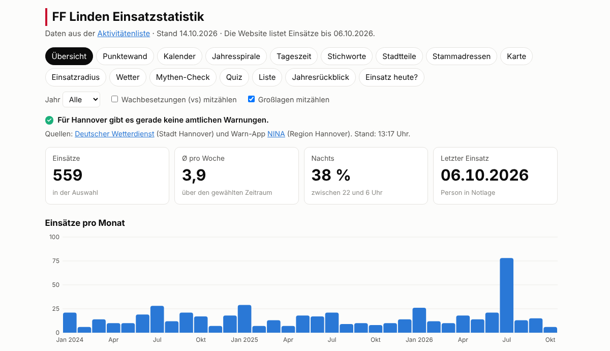
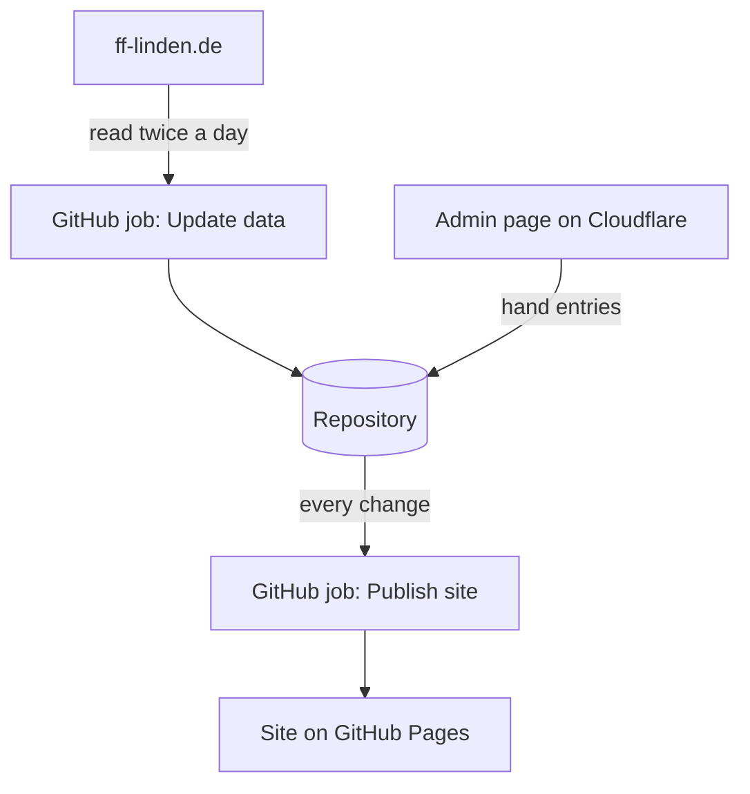

# FF Linden Einsatzstatistik

All alarms (Einsätze) of the Freiwillige Feuerwehr Hannover-Linden as charts, maps and a quiz, taken from the
public [Aktivitätenliste](https://www.ff-linden.de/veranstaltungsliste/) of the FF Linden website.

**Site:** https://reagans94.github.io/FF_visualizer/ · **Admin page:** https://ff-linden-admin.ff-statistik.workers.dev/



## What's on the site

| Tab | Shows |
| --- | --- |
| Übersicht | Totals, alarms per month, current official warnings for Hannover |
| Punktewand, Kalender, Jahresspirale | Every alarm as a dot, a day square or a piece of a yearly spiral |
| Tageszeit, Stichworte, Stadtteile, Stammadressen | When, what and where, and the addresses that come up again |
| Karte, Einsatzradius | The alarms on a map, and how far they were from the Wache |
| Wetter, Mythen-Check | Whether weather, full moon, 96 games and more change anything |
| Quiz, Liste, Jahresrückblick | A guessing game, the searchable list, the year in review |
| Einsatz heute? | A rough guess at the chance of an alarm today, clearly marked as a guess |

How the tabs count is explained in [docs/features.md](docs/features.md).

## How it fits together



- **Update data** fetches the alarm list, weather, 96 games and street positions, and saves them in
  `web/public/data/`. More in [docs/data.md](docs/data.md).
- **The admin page** adds alarms the website doesn't list yet. Only people in its Cloudflare Access list can log
  in. More in [docs/admin.md](docs/admin.md).
- **Two keys, opposite directions:** GitHub holds a Cloudflare key (`CLOUDFLARE_API_TOKEN`) to upload the admin
  page. Cloudflare holds a GitHub key (`GITHUB_TOKEN`) so the admin page can save entries.

## Everyday tasks

- **Add an alarm the website doesn't list yet:** on the admin page. It shows as "vorläufig" until the website
  lists it, then the website's row takes over.
- **Let a colleague add alarms:** add their email to the policy of the "ff-linden-admin" application in
  Cloudflare Zero Trust → Access controls → Applications. They log in with that email, see [docs/admin.md](docs/admin.md).
- **Fix a keyword's name:** edit `web/public/data/keywords.json` on GitHub.
- **Once a year:** add the next school year to `web/public/data/ferien.json`.

## When something looks wrong

| You see | Look here |
| --- | --- |
| Old alarms on the site | Actions → "Update data" and "Publish site". The FF website itself is often weeks behind. |
| Admin: "Dieses Konto darf keine Einsätze nachtragen" | Your email isn't in the Access policy, or `TEAM_DOMAIN` / `ACCESS_AUD` on the Worker is wrong. |
| Admin: "Der GitHub-Schlüssel … ungültig, abgelaufen" | The Worker's `GITHUB_TOKEN` expired. Make a new one, see [docs/admin.md](docs/admin.md). |
| "Publish admin page" fails | The Cloudflare key on GitHub expired, or a secret has a stray line break. |
| No NINA warnings | The NINA relay Worker on Cloudflare, see [docs/features.md](docs/features.md#the-nina-relay). |

## Where things are

```text
.github/workflows/   GitHub jobs: Update data, Publish site, Publish admin page, Tests
scraper/             Python scripts the "Update data" job runs (alarms, weather, 96 games, street positions)
web/                 the site
  index.html           the statistics page
  admin.html           the admin page
  public/data/         the data the jobs and the admin page write (alarms, weather, hand entries, ...)
  src/
    main.js, App.jsx   start-up, and the page around the tabs (header, tab bar, filters, warnings)
    views/             one folder per tab, with its code and styles
    components/        pieces several tabs share (charts, tooltip, warnings, map loader)
    lib/               the rules and calculations, without page code, so they can be tested alone
    admin.js           the admin page's code
admin/               the Cloudflare Worker behind the admin page, and its settings
relay/               the Cloudflare Worker that passes NINA's warnings on
tests/
  unit/                tests of lib/, admin/ and relay/ (Vitest)
  browser/             the site clicked through in Chromium (Playwright)
docs/                the longer explanations linked above
```

## Working on the code

```sh
npm install         # once (needs Node.js 22.12 or newer)
npm run dev         # the site at http://localhost:5173, reloads on every save
npm test            # unit tests (Vitest) and browser tests (Playwright), about two minutes
python scraper/scrape.py --all   # fetch the full alarm history
```

The first browser test run needs `npx playwright install chromium`. "Tests" runs on every pull request and every
change to `main`.
